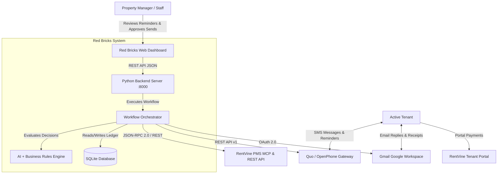

# 🏢 Red Bricks Property Management
# Technical Documentation, High-Level Design (HLD) & Low-Level Design (LLD)

**System:** AI-Powered Automated Rent Reminder Workflow & Operational Dashboard  
**Organization:** Red Bricks Property Management  
**Version:** 2.0.0 (Production / Multi-Line Quo Integration)  
**Status:** Operational  

---

## 1. Executive Overview

The **Red Bricks AI Rent Reminder Workflow** is an enterprise-grade automation agent and property operations dashboard designed to eliminate manual collection follow-ups, prevent wrongful reminder harassment, and maintain continuous financial alignment between property management and tenants.

### 1.1 Core Problems Solved
1. **Human Error in Overdue Tracking:** Manual review of rent balances often leads to missed follow-ups or awkward reminders sent to tenants who already paid or made payment arrangements.
2. **Multi-Channel Message Disconnect:** Tenants communicate across SMS, email, and phone calls. Property managers previously had to check multiple tools before sending an overdue notice.
3. **Sender Identity Confusion:** Property management requires strict operational separation of outbound communication lines (Tenant Reminders vs. Landlord Communications vs. Primary Office Line).
4. **Financial Truth Alignment:** Inconsistencies between raw database balances and official reporting are resolved by establishing **RentVine Report #72 ("Rent Rem Praveen")** as the authoritative source of truth.

---

## 2. Technology Stack & Architectural Principles

The solution is built with a **standard-library-first, dependency-light** architecture for maximum maintainability, speed, and zero build friction.

| Layer | Technologies Used | Purpose & Rationale |
| :--- | :--- | :--- |
| **Backend Core** | **Python 3.10+** (Standard Library: `http.server`, `urllib.request`, `sqlite3`, `dataclasses`, `json`, `threading`) | Zero heavy framework overhead (no Flask/Django/FastAPI bloat); instant startup, 100% portable. |
| **Database** | **SQLite 3** (`redbrick_records.db`) | Fast, file-based, transactional ACID database with thread-safe connection pooling and WAL mode. |
| **Frontend UI** | **Vanilla HTML5, CSS3, Modern ES6+ JavaScript** | No node_modules, Webpack, or Babel build step required. Direct browser execution with dark-mode glassmorphic aesthetics. |
| **Property Management** | **RentVine MCP** (JSON-RPC 2.0) & **RentVine REST API v2** | Read-only ledger queries, active lease synchronization, Report #72 ingestion, and note write-backs. |
| **SMS Gateway** | **Quo (OpenPhone) REST API v1** (`https://api.openphone.com/v1`) | Outbound reminder delivery, multi-inbox switching, 7-day conversation retrieval, and incoming SMS webhook parsing. |
| **Email Channel** | **Google Workspace Gmail API** (OAuth 2.0 Read-Only) | Monitoring incoming tenant emails, receipts, and dispute notices. |
| **AI Intent Classification** | **Groq LLaMA 3.3 70B Versatile** / **OpenAI GPT-4o-mini** + Heuristic Engine | Natural Language Understanding (NLU) of tenant replies with automatic fallback to local regex heuristics. |
| **Scheduler** | **Azure Scheduler / Cron** (`0 8 * * *`) | Automated daily triggering at 08:00 UTC with manual HITL triggers via the web dashboard. |

---

## 3. High-Level Design (HLD)

### 3.1 System Context (C4 Level 1)



### 3.2 Container Architecture (C4 Level 2)

```mermaid
graph TB
    subgraph Client Browser
        UI_Home[Flowchart & Operations View]
        UI_Tenants[Tenant Ledger & AI Outcomes]
        UI_Quo[Quo SMS Center & Multi-Line Feed]
        UI_Sim[Tenant Reply AI Sandbox]
        UI_Settings[Config & Connection Probes]
    end

    subgraph Application Server [Python ThreadingHTTPServer]
        API_Router[HTTP Request Handler / Router]
        Sync_Mgr[Background Sync Manager]
        Workflow_Orch[Workflow Orchestrator]
        Rules_Engine[Deterministic Rules Engine]
        AI_Classifier[AI Intent & NLU Classifier]
        Quo_Client[Quo SMS Multi-Line Client]
        RV_Client[RentVine MCP & REST Client]
        Gmail_Client[Gmail OAuth Client]
    end

    subgraph Storage
        SQLite[(redbrick_records.db)]
    end

    subgraph External Cloud Services
        Ext_RV[RentVine API - Report #72]
        Ext_Quo[OpenPhone API v1]
        Ext_LLM[Claude Sonnet / Anthropic / Groq / OpenAI Gateway]
        Ext_Gmail[Google Workspace API]
    end

    Client Browser <-->|HTTP JSON REST| API_Router
    API_Router --> Workflow_Orch
    API_Router --> Sync_Mgr
    Sync_Mgr --> RV_Client
    Workflow_Orch --> Rules_Engine
    Workflow_Orch --> AI_Classifier
    Workflow_Orch --> Quo_Client
    Workflow_Orch --> RV_Client
    Workflow_Orch --> SQLite
    AI_Classifier --> Ext_LLM
    RV_Client --> Ext_RV
    Quo_Client --> Ext_Quo
    Gmail_Client --> Ext_Gmail
```

### 3.3 End-to-End Decision Flow & Execution Logic

```mermaid
flowchart TD
    Start([Daily Run Triggered]) --> S1[1. Fetch Active Tenants & RentVine Report #72]
    S1 --> S2[2. Iterate Over Each Tenant]
    S2 --> Q1{Is Tenant listed in Report #72?}
    Q1 -- No --> D_SkipPaid[Decision: SKIP_PAID\nReason: Not in Report #72 / Balance Cleared]
    Q1 -- Yes --> Q2{Is Total Past Due > $0.00?}
    Q2 -- No --> D_SkipPaid
    Q2 -- Yes --> Q3{Is Account on Manual Exclusion List?}
    Q3 -- Yes --> D_Flag[Decision: FLAG_MANUAL_REVIEW\nAction: Escalate to Manager]
    Q3 -- No --> S3[Fetch Last 7 Days of SMS + Email History]
    S3 --> Q4{Has Inbound Tenant Reply?}
    Q4 -- Yes --> AI_NLU[Run AI Intent Classifier]
    AI_NLU --> Q_Intent{Classified Intent}
    Q_Intent -- PROMISE_MADE --> D_Hold[Decision: HOLD_PROMISE\nAction: Write Note to RentVine & Pause Reminders]
    Q_Intent -- ALREADY_PAID --> D_Claim[Decision: SKIP_PAID\nAction: Hold for Bank Clearance]
    Q_Intent -- DISPUTE --> D_Dispute[Decision: FLAG_MANUAL_REVIEW\nAction: Escalate to Staff]
    Q_Intent -- NO_REPLY / OTHER --> Q5
    Q4 -- No --> Q5{Is Tenant within Grace Period?}
    Q5 -- Yes --> D_Grace[Decision: SKIP_GRACE_PERIOD\nAction: Wait until grace expires]
    Q5 -- No --> Q6{Was Reminder sent in last 24h?}
    Q6 -- Yes --> D_Dedup[Decision: SKIP_ALREADY_REMINDED\nAction: Cooldown active]
    Q6 -- No --> D_Eligible[Decision: SEND_REMINDER\nEligible for Dispatch]
    D_Eligible --> HITL{HITL Mode Active?}
    HITL -- Yes --> Q_Queue[Queue in Quo SMS Center\nAwaiting Manager 1-Click Send]
    HITL -- No --> LiveSend[Transmit via Quo API\nFrom: (980) 300-7559]
    LiveSend --> RV_Note[Write Confirmation Note to RentVine]
```

---

## 4. Low-Level Design (LLD)

### 4.1 Component Specifications

#### 1. Workflow Orchestrator ([`src/workflow.py`](file:///c:/Users/prave/Downloads/redbrick-main/src/workflow.py))
- **Role:** Main coordinator for daily execution cycles.
- **Key Methods:**
  - `execute_daily_run(is_dry_run, reference_time, use_report_source_of_truth)`: Fetches active tenants, evaluates each against business rules and Report #72, creates audit entries, and returns a `DailyRunSummary`.
  - `_process_tenant(...)`: Evaluates a single tenant against deterministic criteria and AI NLU outputs.
  - `generate_daily_report(run_id, format)`: Produces HTML, Markdown, or JSON summaries.

#### 2. Rules Engine ([`src/engine/rules.py`](file:///c:/Users/prave/Downloads/redbrick-main/src/engine/rules.py))
- **Role:** Deterministic compliance and business threshold evaluator.
- **Rules Evaluated:**
  - `check_paid_status`: Evaluates if overdue balance is `$0.00`. (Note: The previous `$20` minimum threshold has been completely removed; all overdue amounts $\ge \$1.00$ are processed).
  - `check_exclusion_list`: Checks for active litigation holds, bankruptcy flags, section-8 special vouchers, or manual manager exclusions.
  - `check_grace_period`: Evaluates monthly grace period (1st–4th of current month suppressed; starting on 5th reminders begin; previous month overdue rent remains eligible under overdue rules).
  - `check_recent_reminder_deduplication`: Enforces 24-hour cooldown between successive reminder dispatches.
  - `is_promise_still_valid`: Verifies if a detected promise date is still in the future.

#### 3. AI Intent Classifier ([`src/engine/classifier.py`](file:///c:/Users/prave/Downloads/redbrick-main/src/engine/classifier.py))
- **Role:** Natural Language Understanding (NLU) of tenant replies across SMS and Email.
- **Architecture:** Dual-layer hybrid classifier:
  1. **Primary LLM:** Groq LLaMA 3.3 70B (`llama-3.3-70b-versatile`) or OpenAI GPT-4o-mini with structured JSON prompt enforcing schema `{intent, extracted_date, extracted_amount, confidence, reasoning}`.
  2. **Fallback Engine:** Zero-dependency regex pattern matcher for date extraction (`by Friday`, `on the 15th`, `tomorrow`), paid claims (`already sent`, `paid online`), and disputes (`wrong amount`, `maintenance issue`).

#### 4. Quo (OpenPhone) SMS Multi-Line Client ([`src/clients/quo_sms.py`](file:///c:/Users/prave/Downloads/redbrick-main/src/clients/quo_sms.py))
- **Role:** Multi-inbox gateway routing outgoing SMS through dedicated lines based on recipient type.
- **Multi-Line Number Configuration:**
  - **Tenants & Vendors Line:** `(980) 300-7559` (`PNnMjdTFVO`) -> Used strictly for rent reminders and tenant follow-ups.
  - **Landlords Line:** `(980) 300-1196` (`PNTDARdwBh`) -> Used strictly for landlord communications and updates.
  - **Primary Line:** `(667) 281-3879` (`PNz3t43PKv`) -> Isolated general inbox (never used for rent reminders).
- **Safety Safeguard:** During testing phase (`QUO_MOCK_MODE=true` or suppressed mode), live carrier transmission is prevented while saving full audit records to the database. Live delivery occurs under manager approval via `POST /api/send-reminder`.

#### 5. RentVine MCP & REST Client ([`src/clients/rentvine_mcp.py`](file:///c:/Users/prave/Downloads/redbrick-main/src/clients/rentvine_mcp.py))
- **Role:** Bi-directional sync with RentVine Property Management System.
- **Functions:**
  - Ingests **RentVine Report #72 ("Rent Rem Praveen")** directly from `https://redbricksproperties.rentvine.com/reports/lease-balances?reportID=72`.
  - Paginates through `/api/v2/leases`, `/api/v2/tenants`, and `/api/v2/properties`.
  - Writes automated notes back to the RentVine tenant ledger: `write_tenant_note(tenant_id, note_text)`.

#### 6. Synchronization Manager ([`src/sync_manager.py`](file:///c:/Users/prave/Downloads/redbrick-main/src/sync_manager.py))
- **Role:** Multi-threaded synchronization engine preventing dashboard race conditions.
- **Mechanism:** Coordinates live RentVine fetching into local SQLite tables before releasing dashboard updates, guaranteeing final accurate counts for active leases, paid balances, and eligible overdue reminders.

---

### 4.2 Database Schema ([`src/database.py`](file:///c:/Users/prave/Downloads/redbrick-main/src/database.py))

```sql
-- 1. Tenants Table
CREATE TABLE IF NOT EXISTS tenants (
    id TEXT PRIMARY KEY,
    first_name TEXT NOT NULL,
    last_name TEXT NOT NULL,
    phone TEXT,
    email TEXT,
    property_name TEXT,
    unit_number TEXT,
    monthly_rent REAL DEFAULT 0.0,
    is_active INTEGER DEFAULT 1,
    is_excluded INTEGER DEFAULT 0,
    exclusion_reason TEXT,
    created_at TEXT
);

-- 2. RentVine Financial Records
CREATE TABLE IF NOT EXISTS rentvine_records (
    tenant_id TEXT PRIMARY KEY,
    balance REAL NOT NULL,
    due_date TEXT NOT NULL,
    last_payment_date TEXT,
    last_payment_amount REAL DEFAULT 0.0,
    portal_link TEXT,
    lease_status TEXT,
    updated_at TEXT,
    FOREIGN KEY (tenant_id) REFERENCES tenants(id)
);

-- 3. Communication Audit Trail (SMS & Email)
CREATE TABLE IF NOT EXISTS communication_messages (
    id TEXT PRIMARY KEY,
    tenant_id TEXT NOT NULL,
    channel TEXT NOT NULL,       -- 'SMS' or 'EMAIL'
    direction TEXT NOT NULL,     -- 'INBOUND' or 'OUTBOUND'
    sender TEXT NOT NULL,        -- '(980) 300-7559', '(980) 300-1196', or tenant
    recipient TEXT NOT NULL,
    content TEXT NOT NULL,
    timestamp TEXT NOT NULL,
    status TEXT NOT NULL,        -- 'SENT_HITL_APPROVED', 'DELIVERED', 'REMINDER_NEEDED'
    metadata TEXT,               -- JSON: inbox, line, provider, hitl_approved
    FOREIGN KEY (tenant_id) REFERENCES tenants(id)
);

-- 4. Workflow Decisions
CREATE TABLE IF NOT EXISTS decisions (
    id INTEGER PRIMARY KEY AUTOINCREMENT,
    tenant_id TEXT NOT NULL,
    tenant_name TEXT,
    property_unit TEXT,
    balance REAL,
    outcome TEXT NOT NULL,       -- 'SEND_REMINDER', 'SKIP_PAID', 'HOLD_PROMISE', etc.
    reason TEXT,
    details TEXT,                -- JSON: sms_text, sender_phone, force_failed
    timestamp TEXT NOT NULL,
    sms_sent INTEGER DEFAULT 0,
    sms_message_id TEXT,
    note_written INTEGER DEFAULT 0,
    run_id TEXT,
    FOREIGN KEY (tenant_id) REFERENCES tenants(id)
);

-- 5. Daily Run Summaries
CREATE TABLE IF NOT EXISTS run_summaries (
    run_id TEXT PRIMARY KEY,
    started_at TEXT NOT NULL,
    completed_at TEXT,
    is_dry_run INTEGER DEFAULT 0,
    total_tenants INTEGER,
    count_paid INTEGER,
    count_promised INTEGER,
    count_reminded INTEGER,
    count_skipped INTEGER,
    count_flagged INTEGER,
    count_failed INTEGER,
    total_unpaid_balance REAL
);
```

---

### 4.3 REST API Specification ([`src/server.py`](file:///c:/Users/prave/Downloads/redbrick-main/src/server.py))

| Endpoint | Method | Parameters | Description |
| :--- | :--- | :--- | :--- |
| `/api/status` | `GET` | None | Returns overall health, sync status, active counts, and connection health. |
| `/api/tenants` | `GET` | `?search=&filter=&page=&pageSize=` | Returns paginated list of active tenants with balances and AI decisions. |
| `/api/runs` | `GET` | `?limit=10` | Returns historical summary records of automated workflow runs. |
| `/api/rentvine-report` | `GET` | `?report_id=72` | Returns authoritative live records directly from RentVine Report #72. |
| `/api/rentvine-data` | `GET` | `?section=counts\|properties\|tenants\|leases` | Fetches live paginated portfolio entities from RentVine REST API. |
| `/api/quo-live` | `GET` | `?line=tenants\|landlords\|primary` | Returns active line metadata, conversations, and pending reminder drafts. |
| `/api/run-workflow` | `POST` | `{"is_dry_run": bool, "reference_date": str}` | Triggers complete workflow run across all active leases. |
| `/api/send-reminder` | `POST` | `{"tenant_id", "phone", "text", "hitl_approved": true}` | Dispatches HITL-approved SMS via Quo using `(980) 300-7559`. |
| `/api/simulate-reply` | `POST` | `{"tenant_id", "text", "channel"}` | Simulates tenant reply and tests AI classification in sandbox. |
| `/api/settings` | `GET/POST` | `{"grace_period_days", "dedup_hours", ...}` | Reads and updates business thresholds and Quo phone configurations. |
| `/api/connection-test` | `GET/POST` | None | Tests live ping to RentVine, OpenPhone, and Gmail endpoints. |

---

## 5. Directory Structure & Code Map

```
c:\Users\prave\Downloads\redbrick-main\
├── .env                              # Live environment variables & API tokens
├── .env.example                      # Template documentation for environment keys
├── main.py                           # CLI entrypoint (serve, run, dry-run, seed)
├── redbrick_records.db               # SQLite database
├── src\
│   ├── config.py                     # Configuration loader & Quo sender router
│   ├── models.py                     # Dataclasses & Enums (Tenant, Decision, etc.)
│   ├── database.py                   # Thread-safe SQLite persistence layer
│   ├── sync_manager.py               # Background portfolio & Report #72 synchronizer
│   ├── workflow.py                   # Orchestrator & daily batch execution engine
│   ├── server.py                     # ThreadingHTTPServer & REST API endpoints
│   ├── seed_data.py                  # Realistic demo data populator
│   ├── clients\
│   │   ├── quo_sms.py                # Quo (OpenPhone) multi-line SMS client
│   │   ├── rentvine_mcp.py           # RentVine MCP JSON-RPC & Report #72 client
│   │   └── gmail_client.py           # Gmail OAuth 2.0 email client
│   └── engine\
│       ├── rules.py                  # Deterministic compliance rules engine
│       └── classifier.py             # Dual-layer AI intent classifier (LLM + Regex)
├── web\                              # Web Application Frontend
│   ├── index.html                    # Single-page operations dashboard
│   ├── css\
│   │   ├── styles.css                # Dark-mode design system & layout
│   │   └── flowchart.css             # Interactive architectural flowchart styles
│   └── js\
│       ├── app.js                    # Main dashboard controller & Quo live feed
│       ├── flowchart.js              # Interactive node graph controller
│       ├── simulator.js              # AI NLU sandbox simulator
│       └── tenant-drawer.js          # Slide-out tenant ledger & conversation drawer
└── tests\
    ├── test_classifier.py            # AI intent classification unit tests
    ├── test_rules.py                 # Deterministic rules engine unit tests
    └── test_workflow.py              # End-to-end workflow & Quo routing tests
```

---

## 6. Developer Setup & Operational Runbook

### 6.1 Prerequisites
- Python 3.10+
- Internet connection for RentVine & Quo REST API communication.
- No external Python package dependencies required for core operation.

### 6.2 Running the Application
```powershell
# 1. Clone or navigate to the project directory
cd c:\Users\prave\Downloads\redbrick-main

# 2. Run unit tests to verify system integrity
python -m unittest discover -s tests

# 3. Seed database with initial sample tenants (optional)
python main.py seed

# 4. Start the live server daemon
python main.py serve
```
The dashboard will be accessible at `http://127.0.0.1:8000/`.

### 6.3 Quo Phone Routing Verification
- Tenant rent reminders are dispatched from **`(980) 300-7559`** (`PNnMjdTFVO`).
- Landlord communications route to **`(980) 300-1196`** (`PNTDARdwBh`).
- The primary line **`(667) 281-3879`** (`PNz3t43PKv`) remains isolated.
- The SMS Reminder Center in the web dashboard provides an inbox switcher to inspect conversations across each line.
